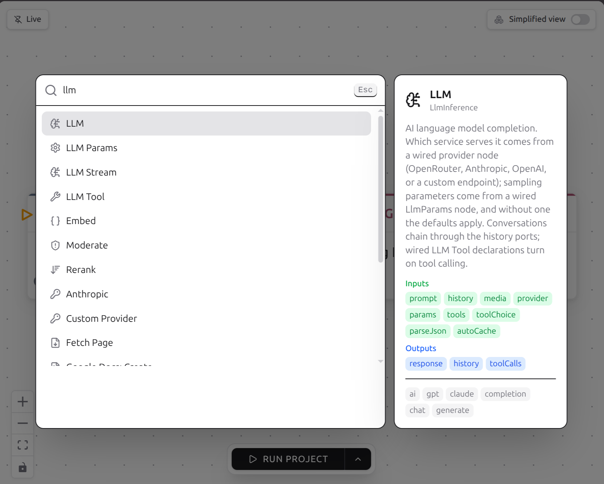
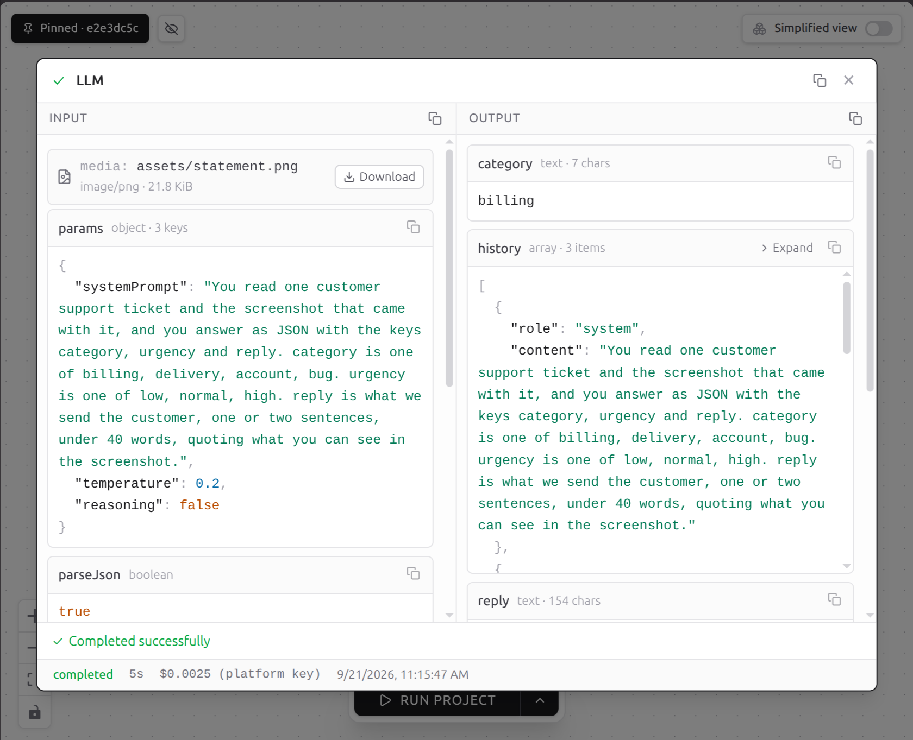
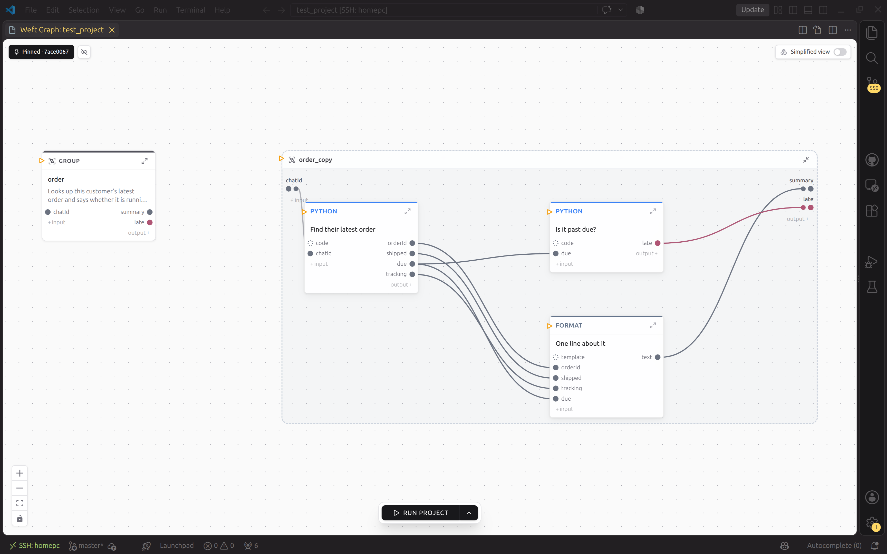

# Working in the graph

Everything here works with the mouse. Whatever you change on the canvas is
written into your `.weft` file, so the two never disagree. The one exception is
where a box sits: positions are kept in `layouts/`, beside your source.

## Getting around

Scroll to move around. Drag empty canvas to move around faster. Zoom is the
`+` and `-` buttons at the bottom left, with **Fit View** beside them for when
you drag something into the distance and lose it. Scrolling does not zoom, on
purpose, so a stray trackpad gesture cannot throw your whole graph off screen.

Hold **Shift** and drag to select several boxes at once.

## Add a node

Press **Ctrl+P** (**Cmd+P** on a Mac) and search. Right-clicking empty canvas
and picking **Add Node...** opens the same list.



The list holds every node your project knows about, and `Group` and `Loop` are
in there too.

It also holds the plain actions, so you can find them without remembering a
chord: Undo, Redo, Duplicate Selected, Delete Selected, Select All Nodes, Fit
View, and Auto Organize Layout, which tidies the whole canvas.

If you already know what should come next, drag out of a dot and let go over
empty canvas. The list opens, and the node you pick arrives with the arrow
already drawn. One **Ctrl+Z** takes away both.

If the text of the file changes outside the graph (you type in the code tab,
or an AI writes the file), the graph forgets its undo history, because what it
remembered no longer matches the text. Undo those earlier graph edits in the
text editor instead. The graph never writes over a change made to the text.

## Connect two nodes

Drag from a dot on one box's right edge to a dot on another box's left edge.
The line takes the colour of the dot it started from.

Three things will refuse the drop, and each tells you which:

- **The types do not fit.** Same colour is the quick check. The full rules are
  in [Types](../language/types.md).
- **The two boxes are in different groups.** A value crossing that line has to
  go through the group's own dots. That is what a group is for.
- **The input already has a value written into it.** You get
  `'<port>' is driven by a config assignment; unset it first to drive it with an edge.`
  Clear the field, then draw the arrow.

Near the top of each node's right edge, set apart from its output ports, there
is a small red circle with a `!` in it. That is `_error`, where the node's
failure comes out, and you drag a wire out of it as you would from any output. While nothing is wired
to it, it is an outline and a failure stops the run. Once a wire leaves it, it
fills in red, and a failure goes down that wire instead. For which failures go
there, go and read [when a node fails](../language/how-a-program-runs.md#when-a-node-fails).

To remove an arrow, grab it near one end and drop it on empty canvas.

To take one field out of a value instead of the whole thing, right-click the
arrow. You get the keys inside it with their types, and clicking one narrows
the arrow to that key. **Up one level** goes back and **Read the whole value**
undoes it.

## Values written by metadata ports

A metadata port is a value fixed in the program, which the compiler copies
into every input the code wires from it, before anything runs. For what
metadata ports are for, go and read
[metadata ports](../language/groups.md#metadata-ports).

The graph draws neither the ports nor the wires from them: both are written
in the code (`tools.search = search.tool`, or a value gathered from several,
`self.tools = [...screen.tools, pause.tool]`). What it shows is where each
value comes from, and it lets you follow it:

- **An input a metadata port fills** shows the value, read-only, with a link
  such as *from `calls.tools`* beside its name. Click it and the editor takes you to
  that box, opening the groups it sits in.
- **A group's metadata ports** show in the **Config** strip at the top of the
  open group. A value written out in full is a field you can edit there. A
  value gathered from others is read-only, written the way the code writes
  it, with each port it names as a link: follow the links down until you
  reach the box that writes the text itself.

## Change what a node does

The small arrow in a box's header opens its body, where its fields are: text
boxes, dropdowns, tickboxes, code editors, file pickers. A field fed by an
arrow hides itself, because the arrow is now the source of that value.

Under the inputs there is a **+ input** button, and **output +** under the
outputs. A port you add with no type takes its type from what you wire to it.
If you want to set one yourself, right-click the new dot and pick the
**Type:** row.

That same right-click menu makes an input required or optional, removes it, or
puts a catalog port back the way it was.

Double-click a box's name to rename it. Right-click a box for **Duplicate**,
**Delete** and **Tags…**.

On an infra node, the same menu has **One per instance**: each instance of
your program then gets its own copy of it, and it shows a **per instance**
badge. **Share across instances** takes the mark off.

If you want each instance to get its own value for a field (an account, a
spreadsheet, a schedule), click the ⧉ button beside the field's name, or
right-click the field and pick **Let each instance fill this** (the same entry
is on the right-click menu of the field's input port). The field then shows
**Filled per instance** instead of a control, and the node a **filled per
instance** badge. If you had already written a value, an instance that gets
none gets that one. Click ⧉ again, or pick **Stop letting each instance fill this**,
and that value becomes the one value for everyone again, or the field goes back
to empty if there was none. A field with a wire into it offers neither, because
its value comes from the wire.

A box that reads from a per-instance node or an instance-filled field runs once
for each instance too, and shows a dashed **per instance (follows)** badge. For
what all of this means, go and read
[programs with instances](../running/instances.md).

## Run part of the graph

Select the boxes whose answers you want (click one, or hold **Shift** and drag
around several). The selection bar appears at the bottom center of the canvas
with a big **RUN 2 TARGETS** button (**RUN 1 TARGET** if you picked one box).
Click it, or press **Ctrl+Enter**, and those boxes run together with everything
they need. That is the same run as:

```bash
weft run --target dailyReport --target weeklyReport
```

To work out what a box needs, weft follows the wires back up from it and
stops at any trigger. That trigger does not fire in this run, so a box only a
trigger feeds is skipped. If you want that box to run, fire the trigger with a
made-up event from the CLI (`weft run --fire`). A box that two branches share
does not drag the other branch in. If the box sits inside a group, only the
boxes of that group it needs run, plus whatever feeds the switch that decides
whether the group runs at all (its `_should_flow` or `_should_not_flow`). If weft reaches a loop on the way, the whole loop comes along, and a
box inside a loop cannot be picked on its own: Run stays grey and tells you to
select the whole loop.

Triggers and infra have no Run button: select one and the bar offers its own
buttons instead (**Turn on**, **Turn off**, **Resync** for a trigger; **Start**,
**Stop**, **Upgrade**, **Terminate** for infra; covered
[below](#turn-triggers-and-infra-on-and-off)). If you select them together
with other boxes, **RUN N TARGETS** counts and runs the other boxes. Pressing
**Ctrl+Enter** with only triggers or infra selected tells you Run leaves them
out.

While weft works out what the selection needs, the button is greyed out and
says `Checking what this run needs...` on hover. If the run cannot start,
the button stays grey and its tooltip gives weft's reason: the refusal
`weft run --check` prints, or the infra the run reads that is not running
(`Start db first: this run reads it, and it is not running.`). Several boxes
selected are one run, so one blocked box blocks it: the tooltip names each
blocked box with its reason, and the boxes that could run on their own.

If you want the whole program, open the **Weft** icon in the side strip and
click **Run Project** on the project's row. That is a plain `weft run`.

The editor has no button for starting partway in with values you supply,
running one group on its own, firing a trigger with a made-up event, running a
saved example (`examples/*.json`) or reusing what did not change since the last
run. For those, use [the CLI](../running/cli.md#run-something): `--from`,
`--group`, `--fire`, `--seed`, or an example's name after `weft run`. For the
rules behind them, go and read
[versions, seeds and frozen examples](../running/versions.md).

## Watch it go

The status bar, at the very bottom of the canvas, is the same bar as the
selection bar above: what is happening now comes first, then what the
selected boxes offer. With nothing selected and nothing going
on, it is not drawn (the eye buttons that show only the trigger or the infra
subgraph stay). While the run on the graph is going, it shows **Stop** and how far the run
got (`run 3f2a... 4/9 nodes`). Which run that is depends on the toggle in
[look at an older run](#look-at-an-older-run). The bar also shows work started
elsewhere: an
`infra start` typed in a terminal, or asked for by Tangle, shows as
**Starting infra...**, an activation as **Turning triggers on...**, a build as
**Building...**. If that work can still be cancelled, the label ends in
**(Cancel)**, and clicking the label cancels it.

If a command fails, a red banner sits above the bar with the error. Click it
for the whole message, and the **×** to dismiss it. A dark line above the bar
shows the last thing the command printed, while it runs and, if it failed, for
as long as the banner is up. Clicking it shows everything it printed.

Each box gets a glow and a small mark:

| The box | What happened |
|---|---|
| Amber glow, `●` | Running now |
| Cyan glow, `◉` | Waiting for an answer from outside |
| Green glow, `✓` | Finished |
| Red glow, `✕` | Failed |
| Grey `■` | You stopped it |
| Grey `⊘` | Skipped |
| Purple glow | Reused from an earlier run instead of run again |
| Dimmed, no glow | Outside the part of the graph this run covered |

Click the magnifying glass in a box's header, **Inspect run**, for what
went in, what came out, how long it took and what it cost. A failed box shows
its error there. A skipped box says why in words, such as
`its _should_flow said no` or `the required input 'x' closed`, and you follow
the arrows backwards from there to find the node that decided. A bus's
messages end with `* the bus closed here`, or with `* the bus failed here:`
and the reason when it broke off (go and read [how a bus
ends](../language/streams-and-buses.md#how-a-bus-ends)). If a node
changed a stored file in place (added a turn to a conversation, say), its panel
lists each change under **Files edited**: the file, the versions it moved
between, and the lines added and removed.



A box that ran several times, which happens inside a loop, gets a `‹ 2/5 ›` in
its header to step through the firings.

## Look at an older run

The toggle at the top left decides which run the graph shows. Hover any of
its three parts to see what it does:

- **Following** puts every run that starts on the graph. It is the default,
  and clicking **Run** in the editor always comes back to it.
- **Locked** keeps the graph on the run it shows, so you can read it while
  others start.
- **Off** takes the run away and leaves just the program.

While locked or off, runs that start are counted in a button beside the
toggle, like **2 new runs · Follow**, and clicking it shows the newest and
follows again. A run started from a terminal, yours or an assistant's, never
changes the mode. Each project remembers whether you left it following.

For a run from yesterday, click the **Weft** icon in the side strip.
**Runs** lists every run of the project you last opened, newest first,
and each row has **View in Graph**, which puts that run back on the canvas with
its values in place and locks the toggle onto it. A replayed run looks exactly
like a live one.

If your project deploys to a cloud install, the switch at the top right shows
the graph as that install runs it. For how it works, go and read
[Look at prod from the editor](../running/cloud.md#look-at-prod-from-the-editor).

## Turn triggers and infra on and off

Select a trigger or an infra node, or several (with the graph focused,
**Ctrl+P** opens its list, and **Select All Triggers** there picks every
trigger). The selection bar then offers what each can do right now, with a
count when a button covers more than one of the selected nodes:
**Turn on**, **Turn off** and **Resync** for triggers, **Start**, **Stop**,
**Terminate** and **Upgrade** for infra. These are `weft activate`,
`weft deactivate`, `weft resync` and the `weft infra` commands.

If you want to choose how triggers go down, **options...** (shown when a
selected box has something to choose) asks you three
things. What happens to work that arrives while they are down: **Hold it**,
**Hold it, hidden** (held, but not listed for the people who answer your
program's questions), or **Refuse it**. If you hold it, you can also say "then
refuse after N minutes". What happens to work already waiting: **Keep it** or
**Drop it**. And what happens to the runs going now: **Wait for them** or
**Cancel them**.
Each starts on the default the `weft` commands use: **Hold it**, **Keep it**
and **Wait for them**. If you are stopping, terminating
or upgrading infra, the panel asks the same three questions again for the
triggers that go down with it, and names them. For turning triggers on, it asks
what to do with what they held while they were down: **Run it** or **Drop it**.
For what each answer does, go and read
[taking triggers down](../running/lifecycles.md#taking-triggers-down-three-questions).

If a selected node exists once per instance, the bar shows an
**instance:** picker. It starts on **shared**, the copy that belongs to no
instance; you can pick **all instances**, or find or type one instance's id. The pick
applies to every action on the bar and is remembered until you close the
editor.

Each trigger and infra node carries a small badge with its state, and hovering
it says more:

| Badge | What it means |
|---|---|
| `on`, `off`, `turning on...` | The trigger's state |
| `held 3` | Off, with three arrivals or paused runs waiting for it |
| `behind` | On, but firing an older version of the program, or infra running from older source. **Resync** or **Upgrade** brings it up to date |
| `held back` | Taken down by the health check or with its infra, and it cannot come back by itself because other triggers are on another build. The hover names them and says `weft resync --all` |
| `running`, `stopped`, `starting...`, `stopping...`, `terminating...`, `flaky`, `failed` | The infra node's state |
| `3 of 5 on`, `3 of 5 running` | A node that exists once per instance. The hover lists each instance. An infra node no instance has a copy of yet reads `no copies`; such a trigger reads `off` |

If the health check took a trigger down, the hover says so. With the built-in
health rules, the trigger comes back on its own once its infra is healthy. If
the infra node's own rules never bring it back, click **Turn on**. For what
the health check watches, go and read
[when a unit stops being ready](../nodes/infrastructure.md#when-a-unit-stops-being-ready).

If a resync stopped partway with triggers still down, the status bar shows
**Resync stopped**, with **Resync** to pick it up where it stopped and
**Give up** to leave those triggers off.

## Fold a big program down

Every group has **Collapse group** in its header, and **Expand group** when it
is shut. The wiring outside does not change either way. Groups start shut.

If you are zoomed in when you open a group, the view zooms out around your
mouse until about a dozen of its boxes fit on the screen. If closing one
leaves five boxes or fewer on screen, the view zooms back in. Each zoom takes
under half a second, and scrolling or dragging during it stops it where it
is.

An included file's box has an **Open** button that shows that file's own
graph, where you can edit it. There, the group holding the whole file starts
open. **Return** at the top left takes you back.



To make a group, add a `Group` from the list (**Ctrl+P**) and drag boxes into it. weft decides where
a box landed from its centre, so drag it until its middle is inside. To undo
that, delete the group: every box inside climbs out one level and keeps its
position.

Moving a box in or out of a group changes your program, because it changes what
that box can reach. Dragging a box anywhere else does not: positions live in
`layouts/`, beside your source, not in it.

To show your program to somebody, there is a **Simplified view** switch at the
top right. Every box becomes a plain square with one dot on each side. You can
still move boxes and fold groups, and you cannot wire anything, which is the
point.

Next, [connect an account](connections.md).
