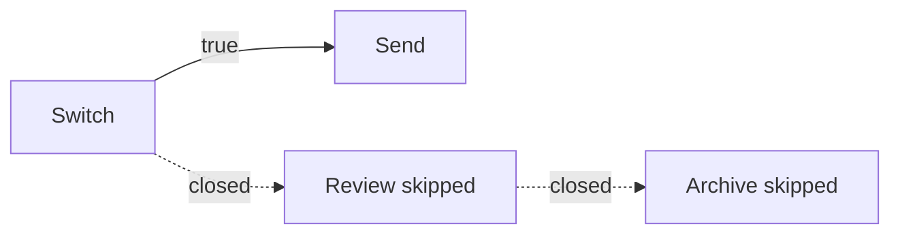

# How a program runs

Do not read a weft program top to bottom. A node can send its answer before it
has finished, or sit waiting for a week while the rest of the program carries
on. If you want to predict what happens, look at what arrives at each node's
inputs.

## Values arrive one at a time

When a node emits, the value travels along every arrow leaving that output.
Each delivery is a **pulse**, aimed at one input, carrying a tag saying which
run it belongs to. One output wired to three inputs is three deliveries.

A node waits until every input with an arrow into it has either a value or a
closure. Optional inputs count too: an arrow is an arrow. An input can also be
satisfied by a value written into the node or by a default, so not everything
needs an arrow.

Once every wired input has settled, weft decides whether the node runs or is
skipped. A node with nothing wired into it has nothing to wait for, so weft
starts it when the run begins.

## How a branch stops the nodes after it

Here is the problem. A node decided not to send anything. Everything wired to
it is now waiting for a value that is never coming. How does the program know
the difference between "not yet" and "never"?

A **closure** is the answer: it is a pulse that says nothing will ever arrive
here, for this run. It is how a node says no rather than saying nothing.

It is not `null`. `null` is a value, and a port whose type allows it takes it
like any other.

Here is what a closure does to the node it reaches:

| What happened | What the node does |
|---|---|
| An input it needs closed | Skips |
| An input you declared `x?: T` closed | Nothing. It runs without that input |
| Every `@require_one_of` input closed | Skips |
| It takes the first of several branches, like `FirstInOrder`, and every one of them closed | Skips |
| `_should_flow` is `false`, or closed | Skips |
| It was waiting on a person, who skipped the question | Skips |

By default a node needs every input that is wired, and writing `?` on one lets
it run without it. For which inputs a node needs, with an example of each, go
and read [optional and required inputs](syntax.md#optional-and-required-inputs).

If every input wired into a node is written with `?`, nothing says when it
should run, and the compiler stops with `run-undecided`: gate it with
`_should_flow`, drop the `?` from the input it cannot do without, or add
`@require_one_of`. A node that joins branches, like `FirstInOrder`, needs none
of these. Neither does a node whose input comes from a port that always
carries something when its group or loop runs, such as a port of a group whose
gate is wired, a group port with a value written on it (`g.x = "hi"`), the
item a loop iterates over (a port named in its `over`), or `self.index`: the
way its value arrives already says when it runs.

A skipped node closes its own outputs, which can skip the next node, and the
next, until the closures reach something that can carry on with what it has.



Streams close differently. A closure on a stream is the stream's end rather
than a skip, so a reader whose stream carried nothing still runs and sees that
nothing came.

A failed node closes whatever it had not already sent. Anything it did send is
not taken back. For how a program carries on past a failure, go and read
[when a node fails](#when-a-node-fails).

## Choosing a branch, and joining back up

Every node has `_should_flow`, and it defaults to true. Wire a value into it to
decide whether that node runs.

Only a literal `false` says no. Any other value lets the node run, and so does
anything the node's own code would have considered falsy. The node never sees
this port: weft checks it before calling in.

`Switch` gives you one output per case. It tries them in the order you wrote
them, and the first one that matches emits `true` while every other one closes.
Wire a case's output into a node's `_should_flow` and that node runs on that
case only. If nothing matches and you gave no `otherwise`, they all close.

To bring two alternative answers back into one arrow, use `FirstInOrder`. It
waits for its wired inputs to settle, then takes the first one that actually
supplied a value, **in written order**. Moving those lines changes which answer
wins. Which one arrived first makes no difference.

`_should_flow` takes one wire, so "only if the model said it was rude *and*
said it was sure" is one gate fed by two conditions. `All` is the AND: wire
both conditions into it and gate on what it emits. It emits when every input
arrived and none of them is `false`, and a branch that closed never arrives at
all, so a closed input is not a `false`.

### Running on the thing that did not happen

Everything above skips when its inputs close. So how do you run a node
*because* something did not arrive?

Wire that something into `_should_not_flow` instead. Every answer flips: a
value arriving means the node stays off, and a closure, the structural "nothing
is coming", is what runs it.

```weft
route = Route -> (body: { title: String, photo?: File }) { path: "cards", method: "POST" }

# A card sent with no picture: the wire reading `photo` closes, so this runs.
defaultArt = FetchToStorage {
  url: "https://example.com/blank.png"
  _should_not_flow: route.body.photo
}
```

This is the one port in weft that starts a node on a closure. Reach for it when
the absence is **data**, like a key the caller did not send. When the absence
is a **decision your own node made**, have that node say so on a second output
and gate on that, because the wire then reads forwards.

A failure is not an absence. When the node it watches fails, its ports close
too, but that closure carries which node broke and its error, and the gate
reads it: the node stays off, skipped with the reason `what its
_should_not_flow watches did not finish ('query' failed: the database is
down)`, and the run reports the failure. So a
"nothing there" branch never runs over a database that is down. The same holds
through a group or a loop: a failure inside closes the scope's outputs with the
failure on them, so a watcher outside reads it as one (and a loop whose
carried value is lost to a failure stops and fails, see
[loops](loops.md#when-an-iteration-fails)). And it holds through a
skip: a node that skipped because its input closed on a failure did not decline
either, so its own ports close with that same failure on them (its skip reason
ends in `because 'query' failed: ...`), and a watcher two nodes down still
reads a failure, not an absence, and still sees `query` named as the node that
broke rather than the node that skipped. The one exception is a node whose
`_error` is wired: it handled its failure, so it counts as finished and its
ports close as plain absences ([below](#when-a-node-fails)).

A node has one gate. Wiring both spellings is the `two-gates` error.

## When a node fails

Left alone, a node that fails fails the whole run. If you want the program to
carry on instead, wire the node's `_error` output. Every node has one, given by
weft. When it is wired and the node fails, the reason comes out on `_error` as
text, the node counts as finished, and every output it had not sent closes.

So to run a backup only when something broke, gate the backup on `_error`:

```weft
fetch = HttpRequest { url: "https://example.com/prices", method: "GET" }

backup = HttpRequest { url: "https://mirror.example.com/prices", method: "GET" }
backup._should_flow = fetch._error
```

When `fetch` works, its `_error` closes and `backup` skips. When the host does
not answer, the reason arrives on `_error` and `backup` runs. The failure still
shows in the node's log, as `failed, handed to the '_error' output: ...`, so
`weft logs` and the inspector tell you it happened.

Only a failure of the node's own work goes to `_error`: a service refusing or
not answering, a script raising, a wait that gave up, a node whose worker died
in the middle of a `durable` run, or a value that does not fit the type you
declared on its output (a model's answer missing a field of the record you
declared on `LlmInferenceJson`, or a value a `Cast` cannot convert). A mistake
in the program, like a bad setting or an input the node cannot read as the
type that input declares, fails the run even with `_error` wired, because only
changing the program fixes it. Scripts are the exception to the output case:
a script's code is part of your program, so a script returning the wrong type
for an output is a mistake in the program and fails the run. For what a script may return, go
and read [declaring ports](syntax.md#declaring-ports), and for which nodes
fail and which run again when a worker dies, [how a run is
kept](triggers-and-routes.md#how-a-run-is-kept). A cancel, or a node pausing
to wait for an answer, is not a failure, so it never comes out on `_error`
either.

**Once a node has started a stream, its failure fails the run.** As soon as
anything went out on a `Bus` or `Generator` output, the readers already hold
part of the answer, and a backup gated on `_error` would send a second answer
on top of it.
The stream ends failed instead, and its readers are told (go and read [how a
bus ends](streams-and-buses.md#how-a-bus-ends)). A producer can open its bus
on the first piece, the way `LlmStream` does. So if a model refuses a prompt
before writing a word, the refusal still comes out on `_error`. The node's bus
port then closes like any output it never sent: a reader that needs the bus
skips, and the backup can answer.

A group, a loop or an included file has no `_error` of its own. If you want to
handle a failure from inside one, take the failing node's `_error` out through
one of the group's outputs, like any other value.

`_error` belongs to weft. A program that declares an output called `_error` on
a node is refused, while `error`, without the underscore, is a name like any
other.

## One node, several firings at once

A **firing** is one go at one node. Three things say which firing you are
looking at: the run, the node, and the loop iterations it sits inside. Inside a
parallel loop the same node can have several firings alive at the same time.

Those iteration numbers are called **frames**. Work at the top level has none,
and work inside two nested loops carries one frame for each. weft only ever
combines inputs whose run and frames match, which is what stops iteration three
eating iteration four's answer.

An ordinary output emits at most once per firing, though it can emit on one
output now and another later. Whatever it never mentions is closed when it
finishes. Generators and buses have their own rules, in
[streams and buses](streams-and-buses.md).

## Groups and loops at run time

When the program runs, no node stands for a group, and a loop becomes two
nodes, a `LoopIn` and a `LoopOut`. For the details, go and read [no node
stands for a group](groups.md#no-node-stands-for-a-group-when-the-program-runs)
and [loops](loops.md).

## What happens when you hit run

A **manual run** starts every node at the top level that has nothing wired into
it, plus every trigger in the project, wired or not. Triggers get no event on a
run like that, so they close their outputs, and only the paths that do not need
an event go anywhere.

To run part of a project:

```bash
weft run --target dailyReport --target alert
```

weft takes those nodes and everything feeding into them, stopping the walk when
it reaches a trigger. A node that several branches share does not drag those
other branches in. A target inside a group brings only the work needed through
it, and the group's `_should_flow` comes along too, unless it is wired straight
from a trigger the run does not fire. A loop the walk reaches from outside
comes along whole: a target after a loop runs every iteration of it. If you
want to run part of a loop's body, start and end the run inside the body
(see [running part of a loop's body](loops.md#running-part-of-its-body)).

What runs is a **cut**: a smaller program holding only what the walk kept,
with every node under its own name, so the journal and the inspector line up
with your source.

You can also start in the middle, handing values in where the walk begins:

```bash
weft run --from classify='{"text":"..."}' --target reply
weft run --group triage='{"text":"..."}'
```

A value you hand in is that port's value: in this run the wire into that port
delivers nothing there, so nothing upstream can replace it. For which flag picks which part of the graph,
go and read [versions, seeds and frozen examples](../running/versions.md).

`--group` runs the group's own nodes and nothing that feeds it, so a group
port wired from outside gets only what you hand it. If a cut leaves an input
with nothing, weft looks at who needs it. When a node would skip without it
(it is an input written without `?`, default or not, other than an input of
a join node such as `FirstInOrder`, which is optional anyway; or the only member
of a `@require_one_of` set that could get a value; the node's own, or one inside the group it enters, followed
through every group, loop and included file on the way), the run is refused
before it starts, naming the input and what it feeds:

```text
triage.text gets nothing in this run: ask.text is outside it, and
triage.classify.text cannot run without it. Hand it a value at this start
(--group triage='{"text": ...}'), run what feeds it with --feed triage, or
start further up so ask runs too.
```

The flag in the message is the one the start was named with: `--group` for a
`--group` start. An input no start lies in front of is named where the wire
lands, and the way to hand it a value is to start there. When the value could
only come from a trigger the run does not fire, the message says so and
offers `--fire` on that trigger as well as handing the value in.

The input is named at the start you gave, even when the missing value would
pass through more group ports on the way (a group inside an included file), and a value you
hand there feeds everything behind it. A trigger's own inputs never count: a
run that does not fire it never reads them. An input that only feeds inputs written with `?`
just closes, with a warning.

A start is where the walk upstream stops, for `--from` and `--group` alike, so
a start's own ports get only what you hand them. To have weft run what feeds
them instead, add `--feed`:

```bash
weft run --from 'hear.note={}' --feed hear.note --target hear.note
```

For each input of `hear.note` you did not hand a value, that runs the node
feeding it and nothing above that node. The value is followed through every
group port it passes, however deeply the groups nest, and a feeder shared by several
inputs runs once. A loop's result comes from the whole loop, so a loop feeding
the start runs whole. You can also
name the feeders as starts yourself (`--from db --from accounts --from
hear.note`): when one start lies upstream of another, the run keeps both, and
`--target` still leaves out every branch that target does not need.

A gate only holds a start back when something in the run decides it. The walk
upstream stops at a start, so the start's own `_should_flow`, and that of each
group it sits inside, stays out of the cut unless another start, or the
trigger you fire, runs whatever feeds it. A group's gate wired straight from a trigger the run
does not fire stays out too, for a start or a target. A wired gate left out
acts as if nothing were wired to it, so the node or group runs (a gate written
in the braces still applies): that is how a node inside a group gated by a
`Route` runs when you start it by hand. If you want the condition checked,
start further up instead, so whatever decides it runs too, or drop the start
and `--fire` the trigger with an event.

Without `--target`, a run goes everywhere downstream of its starts, so
`--from db` alone runs every branch `db` feeds. `--target` narrows that to
what the target needs, starting no further up than the starts. It is one
shape, not a run that goes until it reaches the target.

If you want everything a node needs but not the node itself (say a node
called `post` that publishes the result), end with `--before post` instead of
`--target`.

If you want to get
past a node without running it (a trigger you have not activated, an infra
node, a call you do not want to pay for twice), stand in for it with
`--emit`: `--emit fetch='{"body": "..."}'` says what `fetch` would have sent,
and the run starts from there, the way it starts at a `--from`.

Any of these flags can name a node or a group inside a loop's body, as long as
the run does not cut a loop in half: it holds both ends of a loop (the loop
runs whole, every iteration) or neither (only the part of its body you
picked runs, once). For what that part gets and what is refused, go and read
[running part of a loop's body](loops.md#running-part-of-its-body).

On a `--seed` run the check waits for the seed, since a saved result can
supply the input. It only can when the run it reads completed that node and
the node's code has not changed since; a refused seeded run names the run it
read.

A **trigger firing** picks the work downstream of that trigger, plus whatever
that work needs upstream, again stopping at other triggers. Only the trigger
that fired gets the event; any others close. Two triggers can share the nodes
in the middle without becoming one run.

In a program with instances, a run is also for one instance or for none
(`weft run --instance user-42` picks one). For what is checked before such a
run starts, go and read
[programs with instances](../running/instances.md#what-is-checked-before-a-run-starts).

## How a run ends

A run is finished when there is no work left and nothing still in flight. It
does not need an end node. It can also fail, when a node failed and nothing was
wired to its `_error`, or when weft could get no further. A person or another
run can also cancel it.

A run can pause without ending. **Waiting for input** means a node is parked
on an answer from outside, and the run carries on when that answer comes.

If work is left that can never proceed, weft reports the run as **stuck** and
names the nodes and inputs involved. A run parked on a person's answer is
waiting, not stuck.

## What survives a restart

As a run goes, the worker writes down each thing that happened, in a log called
the journal. Those records are what the graph shows you.

If its worker dies, what happens to a run depends on its trigger's `durable`
setting: for that, go and read [how a run is
kept](triggers-and-routes.md#how-a-run-is-kept). Before you put side effects
around a wait, go and read [surviving a restart](../nodes/durable-execution.md).

## What the build catches

The compiler checks that every arrow's types fit, that every required input is
covered, that no wire crosses a scope boundary it should not, that there are no
cycles, and that the loop and channel restrictions hold. It also runs whatever
validation rules a node declares for itself.

Some things are checked when you build and some only when you run, so a build
can succeed and a value can still be rejected later, when a node emits
something its declared output type does not allow.

It cannot check whether a node does useful work. A model can return a perfectly
typed answer that is wrong. For every rejection by name, go and read
[what the compiler refuses](diagnostics.md). To start writing weft yourself,
carry on to [syntax](syntax.md).
