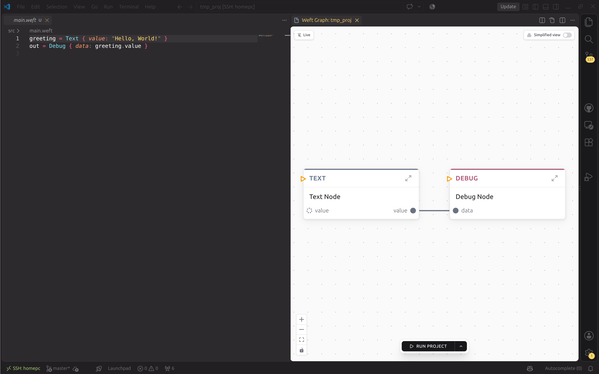
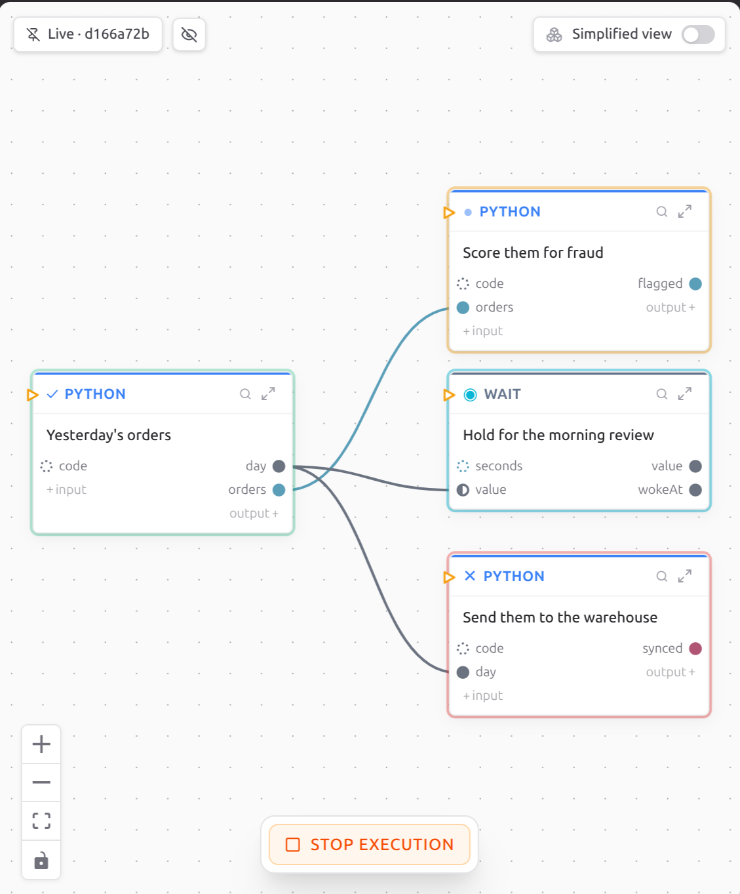

# Your first program

Making a project takes one command, and it has one choice in it: which AI
assistant you use. If you run `weft new hello` with no flag, weft asks you,
listing the assistants it found on your machine first. Or pass `--assistant`
with your row from this table. Either way weft copies Tangle into the project. Tangle is a persona that teaches your assistant
the language, and it reads the catalog on your disk rather than trusting what
it remembers.

| You use | Pass |
|---|---|
| Claude Code | `--assistant claude-code`, or `cc` |
| Kilo Code | `--assistant kilo-code`, or `kc` |
| Cursor | `--assistant cursor`, or `cu` |
| Codex | `--assistant codex`, or `cx` |
| GitHub Copilot | `--assistant github-copilot`, or `gh` |
| Gemini CLI | `--assistant gemini-cli`, or `gc` |
| Cline | `--assistant cline`, or `cl` |
| OpenCode | `--assistant opencode`, or `oc` |
| Devin Desktop | `--assistant devin-desktop`, or `dd` |
| Junie | `--assistant junie`, or `ju` |
| Something else | `--assistant agents`, which writes a plain `AGENTS.md` |
| Nothing | `--assistant none` |

If weft is run from a script or by an AI agent, there is nobody to ask, so it
stops and lists these values: pass one. If you use more than one assistant,
pass `--assistant` once for each. When weft asks, it also asks whether to keep
your answer for later projects. A flag is for this project only, so if you
want your next `weft new` to install the same one with no flag, add
`--remember`, as here:

```bash
weft new hello --assistant claude-code --remember
cd hello
weft run
```

`weft run` says it is building, then prints the project's name and id, then
the run's id and how many nodes it runs, then a line for every node as it
starts and finishes, then a tick:

```text
building hello
registered hello (3f2a1c4e-9b81-4d0a-8e55-7c2f1a6b30de)
started run 9b81d0a2-4e17-4a33-bc90-51d8e2f4a7c1 on version a1b2c3d4
2 nodes
→ started run=9b81d0a2 entry=greeting
  …
✓ completed run=9b81d0a2
```

`hello` uses only the standard library's nodes, so on your machine it runs
the worker program weft ships ready-made (the standard worker), and nothing
compiles. Once a
project has nodes of its own, or infrastructure, its build prints two lines
for each worker it compiles and each infrastructure image it builds,
indented under the rest:

```text
  building <image> as <build>; its log: <url>
  built <image> in about <time>
```

The `; its log: <url>` part shows only when the build has a log to point at.

That long id after `started run` is the run's id, and it is how you
point at this one run later. Everything that reads a run takes it, and the
first eight characters are enough as long as they name only one.

If `weft` is not found, open a new terminal; the installer's `PATH` line only
takes effect in a fresh one. If the run stops saying it cannot reach the
runtime, run `weft daemon status` and go back to [Install](install.md).

## See it as a graph

Open the `hello` folder in VS Code, click the **Weft** icon in the bar down the
left edge, and click your project under **Projects**. The source opens on the
left and the graph opens beside it. (If you opened `src/main.weft` yourself,
click **Open Graph to the Side** in the file's title bar.)

Type in either pane and the other updates.



This is what `weft new` wrote, and what you just ran:

```weft
greeting = Text { value: "Hello, World!" }
out = Debug { data: greeting.value }
```

Two boxes and an arrow. A box is a **node**. The
dots down its left edge are what it takes in, the dots down its right edge are
what it sends out, and each dot is coloured by the kind of value it carries, so
two dots of the same colour fit together.

The arrow is `greeting.value` sitting where `out`'s `data` input goes. Writing
a source and a port where a value belongs is how you connect two nodes, and it
is the only wiring syntax there is.

While a run is going, each box glows: amber while it works, cyan while it waits
for something, grey while it is paused only because its run paused, green when
it finished, red when it failed. Click the magnifying
glass on a box to see exactly what went in and what came out.



For adding a box and drawing an arrow yourself, go and read
[working in the graph](../build/the-graph.md).

## What `weft new` made

| File or directory | What it is |
|---|---|
| `src/main.weft` | The program |
| `weft.toml` | Its name and its permanent id |
| `nodes/base_catalog/` | Every node weft ships, copied in so the build never reaches outside your project. `weft catalog update` replaces this folder wholesale after you update weft, so keep nothing of your own in here |
| `nodes/` (anywhere else) | Nodes you write yourself. A node can also sit under `src/`, next to the module that uses it |
| `CLAUDE.md`, `.claude/` | Tangle, for whichever assistant you picked |
| `.weft/` | Build state, generated |

Two more folders turn up later rather than now: `layouts/`, the first time you
drag a box, and `assets/`, when something needs a prompt or a script kept in a
file of its own.

`weft new` also runs `git init` and writes a `.gitignore`. Tangle's files are
ordinary project files, so they commit with the rest and anyone who clones your
project gets Tangle without installing weft.

Next, [the three lifecycles](lifecycles.md): what starts on its own and what
does not.
